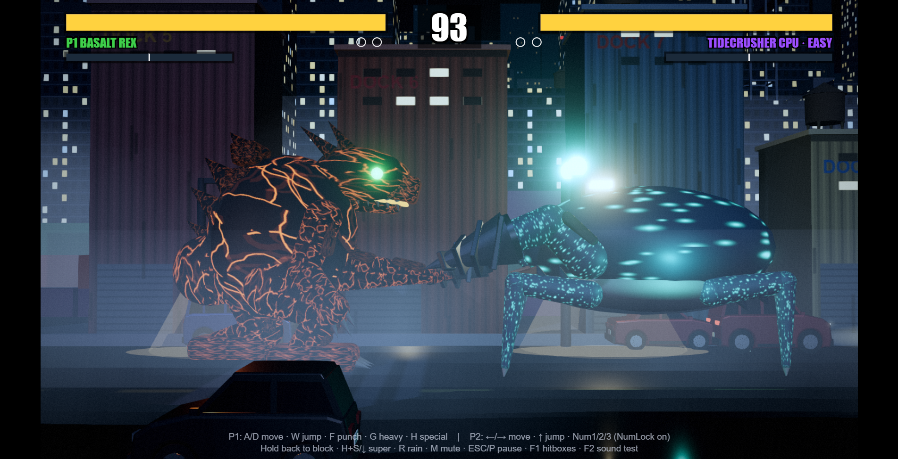
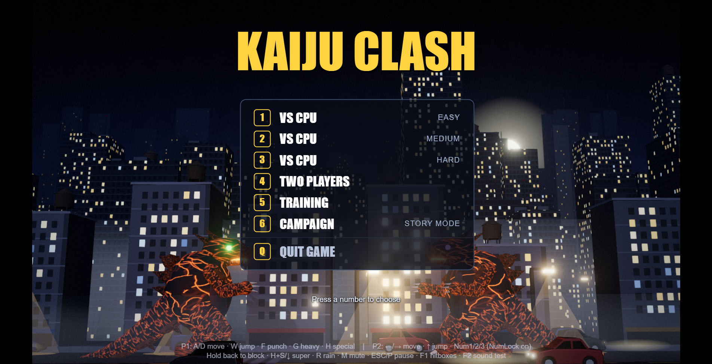
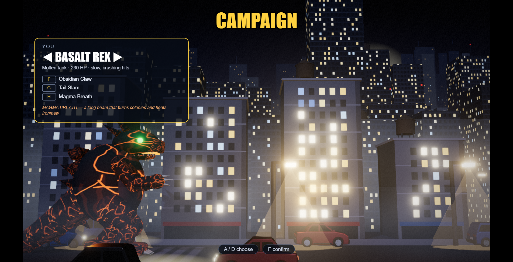
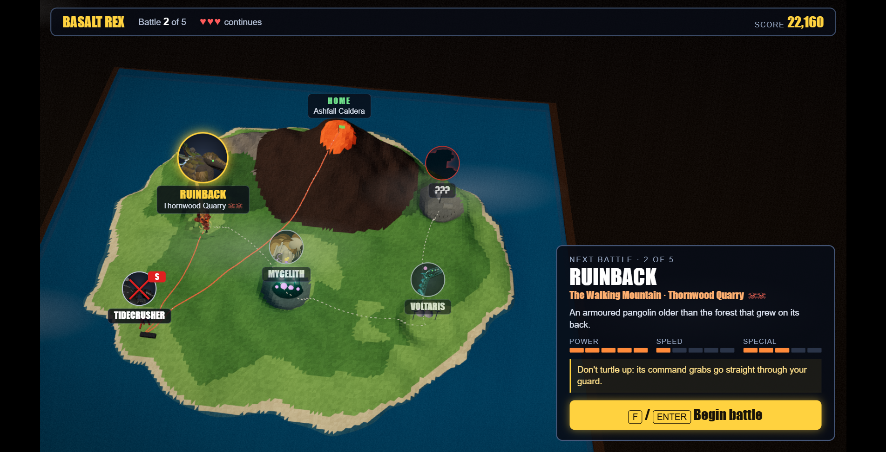

# Kaiju Clash

A 1v1 kaiju fighting game: classic 2D fighting on a single plane, rendered in 3D. Six giant monsters smash through a destructible city at night. Play a story campaign across an island, fight the CPU, or go head to head with a friend on one keyboard.

## Download

| Platform | Download | |
|---|---|---|
| **Windows** | [**KaijuClash-Setup.exe**](https://github.com/mrkmerc/kaiju-clash-releases/releases/latest/download/KaijuClash-Setup.exe) | Installer with desktop and Start Menu shortcuts. Recommended. |
| Windows | [KaijuClash-Portable.exe](https://github.com/mrkmerc/kaiju-clash-releases/releases/latest/download/KaijuClash-Portable.exe) | No install: just double-click and play. Starts a little slower. |
| **macOS** | [**KaijuClash.dmg**](https://github.com/mrkmerc/kaiju-clash-releases/releases/latest/download/KaijuClash.dmg) | Works on Intel and Apple Silicon Macs |

All versions and release notes are on the [Releases page](https://github.com/mrkmerc/kaiju-clash-releases/releases).

**Requirements:** Windows 10 or 11 (64-bit), or macOS 12 or newer. Any computer from the last several years should run it. Lower the graphics quality in the pause menu if it stutters.

### First launch: security warnings

The game isn't code-signed yet, so your computer will warn you the first time you open it:

- **Windows:** if SmartScreen says "Windows protected your PC", click **More info → Run anyway**.
- **macOS:** open the DMG and drag Kaiju Clash to Applications. The first time, **right-click** the app and choose **Open**, then **Open** again. Or go to System Settings → Privacy & Security and click **Open Anyway**.

After that, it opens normally.

## Modes

- **Campaign:** pick a kaiju and march across the island, fighting five battles on themed stages with their own hazards. Earn score, use continues, and unlock more.
- **VS CPU:** Easy, Medium, or Hard.
- **Two Players:** both players on one keyboard.
- **Training:** practice combos and moves.

## The kaiju

| Kaiju | Style |
|---|---|
| **Basalt Rex** | Molten tank: slow, crushing hits and a magma beam |
| **Ironmaw** | Cyborg bio-weapon: jet dash and missiles, but it overheats |
| **Mycelith** | Fungal spore colossus: plants colonies, then springs them |
| **Ruinback** | Armoured pangolin grappler: command grabs build Crush |
| **Tidecrusher** | Armoured siege crab: takes less damage and burrows under you |
| **Voltaris** | Deep-sea eel-dragon: fast whips and electric zones |

## Controls

| | Player 1 | Player 2 |
|---|---|---|
| Move | A / D | ← / → |
| Jump | W | ↑ |
| Block | Hold back | Hold back |
| Punch / Heavy / Special | F / G / H | Numpad 1 / 2 / 3 (Num Lock on) |
| Super | Hold S + H | Hold ↓ + Numpad 3 |
| Other specials (some kaiju) | Hold A or D + H | Hold ← or → + Numpad 3 |

**Esc** or **P** pauses (volume, graphics quality, fullscreen). **F11** toggles fullscreen, **M** mutes, and **R** toggles rain.

## Screenshots

## Your saves

Settings, campaign progress, and unlocks are saved automatically and carry over when you update to a new version:

- Windows: `%APPDATA%\Kaiju Clash`
- macOS: `~/Library/Application Support/Kaiju Clash`

## Updating

The game doesn't update itself. To get a new version, download it from this page. On Windows, run the new installer over the old version. On Mac, replace the app in Applications. Your saves are kept either way.

## Feedback

Found a bug or have an idea? [Open an issue](https://github.com/mrkmerc/kaiju-clash-releases/issues).
